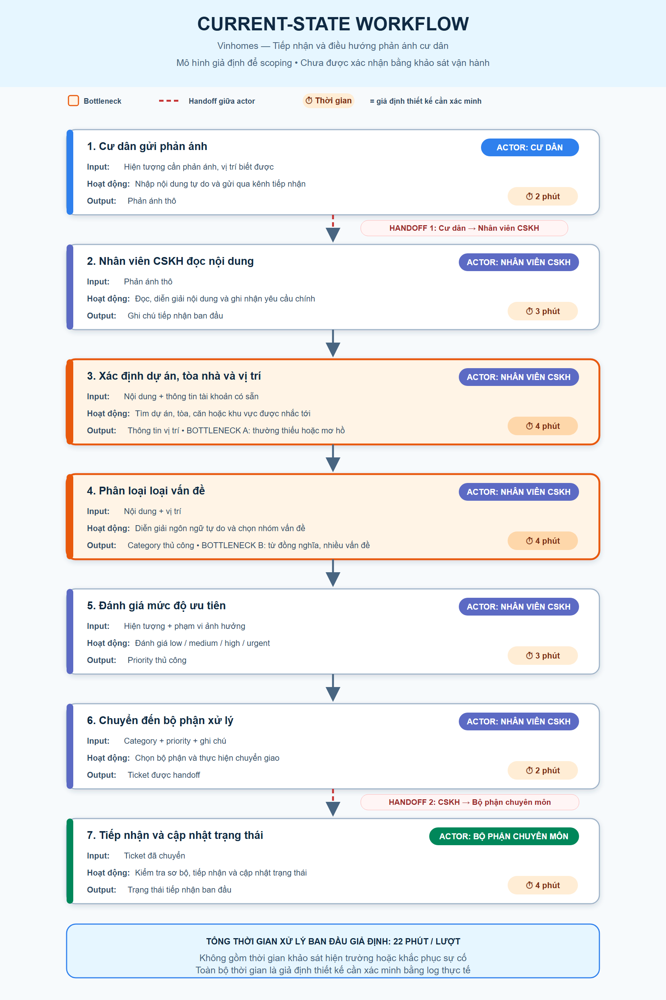

# Deep-Dive Report — Vinhomes phân loại và điều hướng phản ánh cư dân

## 1. Bối cảnh và phạm vi

### 1.1. Bài toán

Cư dân có thể gửi phản ánh bằng ngôn ngữ tự nhiên, trong đó thông tin về dự án, tòa nhà, vị trí, hiện tượng và mức độ ảnh hưởng có thể nằm rải rác hoặc bị thiếu. Bản mẫu đề xuất hỗ trợ nhân viên tiếp nhận bằng cách trích xuất các trường cần thiết, đề xuất một trong bốn category, đề xuất priority, tóm tắt phản ánh và chọn bộ phận theo một bảng mapping cố định.

Đây là **bài thực hiện cá nhân** vì tôi chưa tìm được thành viên. Báo cáo không đại diện cho hoạt động nhóm, không tuyên bố đã họp nhóm, phỏng vấn hay khảo sát thực địa. Điều kiện được phép nộp bài cá nhân cần được xác nhận với giảng viên.

### 1.2. Phạm vi prototype

- Chỉ xử lý bốn category: `electricity` (điện), `water` (nước), `elevator` (thang máy), `sanitation` (vệ sinh).
- `out_of_scope` dùng cho nội dung ngoài bốn nhóm; `unknown` dùng khi không đủ dữ kiện để phân loại.
- AI chỉ tạo kết quả nháp; không tự tạo, gửi, chuyển hoặc đóng ticket.
- Không xử lý quyết định về phí, hoàn tiền, bồi thường, pháp lý, tranh chấp hoặc quy kết trách nhiệm.
- Mọi ticket đều cần nhân viên review; trường hợp thiếu dữ liệu, nhiều cách hiểu, độ tin cậy thấp hoặc có yêu cầu bị cấm phải được chú ý đặc biệt.
- Nguy cơ đối với người hoặc tài sản được gắn `urgent` và yêu cầu con người xử lý ngay; AI không tự thực hiện hành động bên ngoài.

### 1.3. Tình trạng bằng chứng

Repository không cung cấp log phản ánh, SLA, baseline, mapping tổ chức chính thức hoặc dữ liệu phỏng vấn. Vì vậy:

- Các bước workflow là mô hình giả định để scoping, cần được chủ quy trình xác nhận.
- Mọi thời gian là **Giả định thiết kế — Baseline cần được xác minh**.
- Mọi ngưỡng chất lượng là **Mục tiêu đề xuất cho prototype**, chưa phải kết quả đã đạt.
- Tên bộ phận trong router là nhãn chức năng của prototype, chưa khẳng định cơ cấu tổ chức thực tế của Vinhomes.

## 2. Current-State Workflow

### 2.1. Mô tả

Luồng giả định bắt đầu khi cư dân gửi phản ánh. Nhân viên CSKH đọc nội dung, xác định dự án/tòa/vị trí, phân loại vấn đề và đánh giá mức ưu tiên. Sau đó nhân viên chuyển thông tin sang bộ phận chuyên môn; bộ phận này tiếp nhận và cập nhật trạng thái ban đầu.

### 2.2. Bảng chi tiết từng bước

| Bước | Actor | Input | Hoạt động | Output | Thời gian giả định |
|---:|---|---|---|---|---:|
| 1 | Cư dân | Hiện tượng cần phản ánh | Nhập và gửi nội dung | Phản ánh thô | 2 phút |
| 2 | Nhân viên CSKH | Phản ánh thô | Đọc và hiểu nội dung | Ghi chú tiếp nhận | 3 phút |
| 3 | Nhân viên CSKH | Nội dung + thông tin tài khoản có sẵn | Xác định dự án, tòa, căn/khu vực | Thông tin vị trí | 4 phút |
| 4 | Nhân viên CSKH | Nội dung + vị trí | Phân loại loại vấn đề | Category thủ công | 4 phút |
| 5 | Nhân viên CSKH | Hiện tượng + phạm vi ảnh hưởng | Đánh giá mức ưu tiên | Priority thủ công | 3 phút |
| 6 | Nhân viên CSKH | Category + priority + ghi chú | Chọn và chuyển bộ phận xử lý | Ticket được handoff | 2 phút |
| 7 | Bộ phận chuyên môn | Ticket đã chuyển | Tiếp nhận, kiểm tra sơ bộ và cập nhật trạng thái | Trạng thái tiếp nhận | 4 phút |

**Tổng thời gian xử lý ban đầu giả định: 22 phút/lượt.** Tổng này không bao gồm thời gian khảo sát hiện trường hoặc khắc phục sự cố. Đây là giả định thiết kế cần xác minh bằng timestamp/log thực tế.

### 2.3. Handoff và bottleneck

- **Handoff 1:** cư dân → CSKH sau bước 1. Rủi ro là mô tả thiếu vị trí hoặc dùng cách gọi không chuẩn.
- **Handoff 2:** CSKH → bộ phận chuyên môn sau bước 6. Rủi ro là category/priority sai hoặc ghi chú chưa đủ làm ticket bị trả lại.
- **Bottleneck A — bước 3:** xác định vị trí khi nội dung không nêu rõ dự án/tòa/căn.
- **Bottleneck B — bước 4:** diễn giải ngôn ngữ tự do, từ đồng nghĩa và phản ánh có nhiều vấn đề.

Hai bottleneck chiếm **8/22 phút theo giả định thiết kế**; tỷ lệ này không phải số liệu vận hành thật.

## 3. Problem Statement 6-field

| Field | Nội dung |
|---|---|
| **1. Actor / Operator** | Nhân viên CSKH/Ban quản lý tiếp nhận phản ánh; bộ phận điện, nước, thang máy hoặc vệ sinh là bên nhận handoff sau khi con người duyệt. |
| **2. Current Workflow** | Nhân viên đọc phản ánh, xác định vị trí, phân loại, đánh giá ưu tiên, ghi tóm tắt và chọn bộ phận. Luồng giả định gồm 7 bước, mất 22 phút xử lý ban đầu/lượt. |
| **3. Bottleneck** | Thông tin tự do có thể thiếu hoặc mơ hồ; bước xác định vị trí và phân loại đòi hỏi đọc hiểu thủ công, khó chuẩn hóa và có thể gây rework. |
| **4. Business Impact** | Tăng thời gian tiếp nhận, tăng nguy cơ chuyển nhầm và kéo dài thời gian phản hồi. Chưa có dữ liệu để quy đổi thành chi phí, SLA hay ROI; các tác động phải được đo bằng log thực tế. |
| **5. Success Metric** | **Mục tiêu prototype, chưa đạt:** category accuracy ≥ 85%; thời gian AI tạo draft ≤ 2 phút và tổng tiếp nhận ban đầu ≤ 5 phút; route accuracy ≥ 90%; tỷ lệ nhân viên phải sửa category/priority ≤ 20%. Đánh giá trên tập test ẩn danh, có nhãn do con người thống nhất. |
| **6. Operational Boundary** | AI chỉ trích xuất, tóm tắt và đề xuất. Router chỉ đề xuất bộ phận. `requires_human_review` luôn là `true`. Cấm tự tạo/gửi/chuyển/đóng ticket, cam kết bồi thường/hoàn phí, tư vấn pháp lý, quy kết trách nhiệm hoặc tiết lộ PII. Thiếu dữ liệu/không tự tin → `unknown`/review; ngoài scope → `out_of_scope`; nguy hiểm → `urgent` + con người xử lý ngay. |

## 4. AI Fit Analysis

| Phương án | Điểm phù hợp | Hạn chế/rủi ro | Kết luận |
|---|---|---|---|
| **No AI / thủ công** | Không cần dữ liệu huấn luyện, con người kiểm soát trực tiếp. | Chậm, khó chuẩn hóa, không giảm thao tác đọc–nhập. | Giữ làm fallback và baseline. |
| **Rule-based system** | Tốt cho mapping `category → department`, danh sách từ khóa rõ và policy xác định. Dễ audit. | Dễ bỏ sót diễn đạt tiếng Việt đa dạng, phản ánh mơ hồ hoặc nhiều ý. | Dùng cho router, không dùng một mình để hiểu toàn bộ nội dung. |
| **LLM Feature** | Phù hợp với trích xuất từ văn bản tự do, tóm tắt và đề xuất nhãn theo schema. | Có thể hallucinate, bị prompt injection hoặc quá tự tin; cần validation và HITL. | Chọn cho bước hiểu ngôn ngữ, với structured output và boundary chặt. |
| **Agentic Loop** | Có thể gọi nhiều công cụ và tự lập kế hoạch. | Không cần thiết cho luồng tuyến tính; tăng chi phí, độ trễ, quyền tự chủ và rủi ro thực hiện hành động sai. | Không chọn. |

### Kiến trúc được chọn

**LLM Feature + Rule-based Router + Human-in-the-loop.** LLM không trực tiếp quyết định hành động vận hành. Router chỉ ánh xạ đề xuất: `electricity → bộ phận kỹ thuật điện`, `water → bộ phận kỹ thuật nước`, `elevator → bộ phận vận hành thang máy`, `sanitation → bộ phận vệ sinh/môi trường`; `unknown` và `out_of_scope → human_review`. Mapping này là cấu hình prototype và phải được Ban quản lý xác nhận.

Agentic Loop không được chọn vì bài toán không cần vòng lặp tự chủ, không cần AI tự gọi công cụ và không cho phép AI thực hiện chuyển/đóng ticket. Quy trình càng tự chủ thì càng khó audit khi classification hoặc priority sai.

## 5. Future-State Workflow

| Bước | Loại bước | Hoạt động | Kiểm soát/đầu ra |
|---:|---|---|---|
| 1 | Human/Input | Cư dân gửi phản ánh. | Văn bản thô; hệ thống giữ nguyên bản gốc để đối chiếu. |
| 2 | **AI Step** | LLM trích xuất project, building, unit và thông tin còn thiếu. | Trường thiếu dùng `unknown`; không tự suy đoán. |
| 3 | **AI Step** | LLM đề xuất category, priority và summary theo schema. | Chỉ draft, luôn `requires_human_review: true`. |
| 4 | Rule Step | Rule-based Router đề xuất bộ phận từ category. | Mapping có version; `unknown/out_of_scope` đi `human_review`. |
| 5 | **Human-in-the-loop** | Nhân viên đối chiếu draft với phản ánh gốc. | Có thể sửa mọi trường; kiểm tra case `urgent`. |
| 6 | **Human-in-the-loop** | Nhân viên duyệt hoặc chỉnh sửa. | Ghi lại nhãn cuối và lý do sửa để đánh giá prototype. |
| 7 | System after approval | Hệ thống mới chuyển ticket theo thao tác duyệt của nhân viên. | Audit log ghi người duyệt; đây không phải hành động tự chủ của AI. |
| 8 | **Fallback** | Nếu model lỗi, JSON không hợp lệ, thiếu dữ liệu, nhiều cách hiểu hoặc độ tin cậy thấp, quay về luồng thủ công. | Không mất phản ánh; không tự chuyển ticket. |

### Điểm bị cấm tự hành động

AI bị chặn trước mọi thao tác tạo chính thức, gửi, chuyển, đóng ticket hoặc gửi phản hồi cho cư dân. Ngay cả khi `priority = urgent`, hệ thống chỉ đánh dấu và hiển thị cảnh báo để nhân viên xử lý ngay. AI không liên hệ bộ phận, cư dân hay dịch vụ khẩn cấp thay con người.

## 6. AI Readiness Checklist

| Hạng mục | Đánh giá hiện tại | Việc cần làm trước pilot |
|---|---|---|
| Dữ liệu mẫu/log sạch | **Chưa sẵn sàng/không có trong repo.** Chưa biết phân bố category, tỷ lệ thiếu vị trí hoặc chất lượng nhãn. | Thu thập phản ánh lịch sử đã ẩn danh; loại PII không cần thiết; xây guideline và gán nhãn kép category/priority/location. |
| Kiểm soát rủi ro | **Có thiết kế kiểm soát nhưng chưa được kiểm chứng.** Structured output, validation, HITL và fallback giảm rủi ro. | Red-team prompt injection, case nguy hiểm, nhiều vấn đề, tiếng lóng; đo false negative của `urgent`; kiểm thử quyền truy cập và audit log. |
| Khả năng thay đổi quy trình | **Chưa xác nhận với stakeholder.** Prototype thêm một màn hình review thay vì loại bỏ nhân viên. | Xác nhận owner, mapping bộ phận, SLA review, cách hiển thị trường thiếu và cơ chế phản hồi khi route sai. |
| Baseline | **Chưa có.** Thời gian 22 phút là giả định thiết kế. | Lấy timestamp các bước, tỷ lệ chuyển nhầm, tỷ lệ ticket bị trả lại và mức agreement giữa người gán nhãn. |
| Bảo mật/riêng tư | **Chưa đánh giá trên hệ thống thật.** Phản ánh có thể chứa PII và dữ liệu căn hộ. | Xác định mục đích xử lý, quyền truy cập, retention, masking, môi trường test tách biệt và quy trình xóa dữ liệu. |
| Tích hợp kỹ thuật | **Chỉ ở mức prompt prototype.** Chưa kết nối ticketing. | Dùng sandbox/read-only; schema versioning; timeout/retry; monitoring; tuyệt đối chưa cấp quyền gửi/chuyển/đóng. |

### Dữ liệu tối thiểu cần thu thập

1. Tập phản ánh ẩn danh đại diện cho bốn category, `unknown` và `out_of_scope`.
2. Nhãn chuẩn category, priority, location, department và ghi chú bất đồng giữa người gán nhãn.
3. Timestamp từng bước để thiết lập baseline thời gian.
4. Lịch sử sửa category/priority và ticket bị trả lại do thiếu thông tin hoặc route sai.
5. Danh sách biểu thức nguy hiểm và policy escalation được owner phê duyệt.

## 7. Quyết định cuối cùng

### GO — phát triển prototype phạm vi hẹp

GO ở đây chỉ cho phép xây dựng và đánh giá prototype, **không phải triển khai production**. Điều kiện:

- Chỉ bốn category điện, nước, thang máy và vệ sinh.
- AI chỉ tạo draft; mọi kết quả đều cần nhân viên duyệt.
- Chỉ kiểm thử trên dữ liệu đã ẩn danh và có quyền sử dụng.
- Không xử lý tranh chấp phí, hoàn tiền, bồi thường, pháp lý hoặc tình huống ngoài phạm vi.
- Không cấp cho model quyền tự tạo, gửi, chuyển hoặc đóng ticket.

### Lập luận

- **Kỹ thuật:** đầu vào ngôn ngữ tự nhiên và đầu ra hữu hạn phù hợp với LLM có schema; routing hữu hạn phù hợp với rules. Prototype có thể đo được category accuracy, route accuracy, latency và rework mà chưa cần tích hợp hành động thật.
- **Rủi ro:** sai category/priority có thể làm chậm xử lý, đặc biệt với sự cố nguy hiểm. HITL, fallback, `urgent`, audit log và việc không cấp quyền hành động giúp giới hạn tác động trong pilot.
- **Chi phí:** dùng một LLM feature đơn lẻ và router xác định đơn giản hơn Agentic Loop. Tuy nhiên chưa có dữ liệu volume, đơn giá inference, chi phí tích hợp hoặc baseline nhân sự nên chưa thể tuyên bố ROI.

Quyết định cần được xem lại nếu pilot không đạt target, tỷ lệ bỏ sót `urgent` không chấp nhận được, dữ liệu không thể ẩn danh hợp lệ, hoặc nhân viên không thể review trong SLA.
